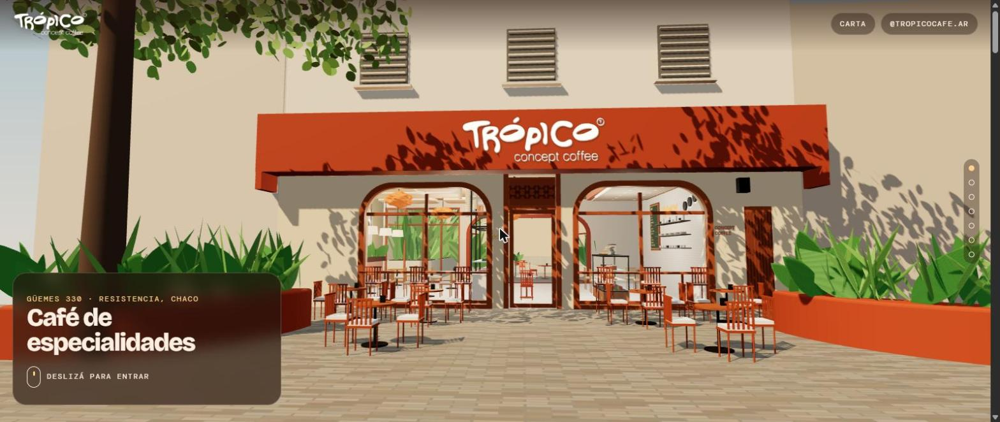
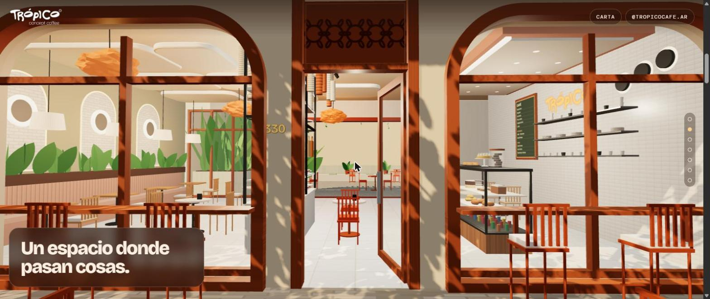
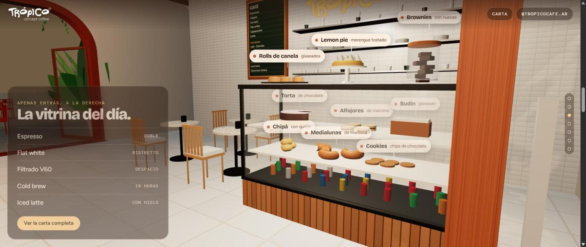
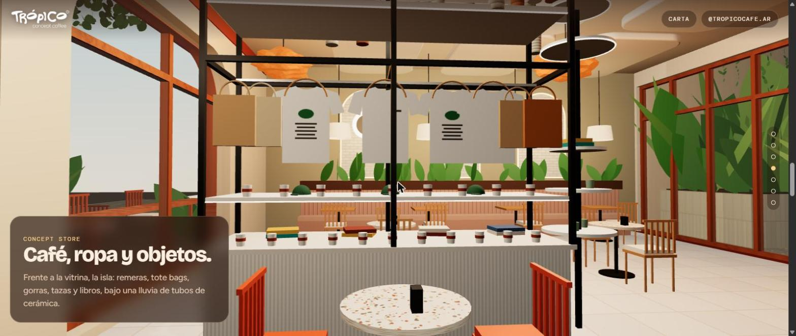
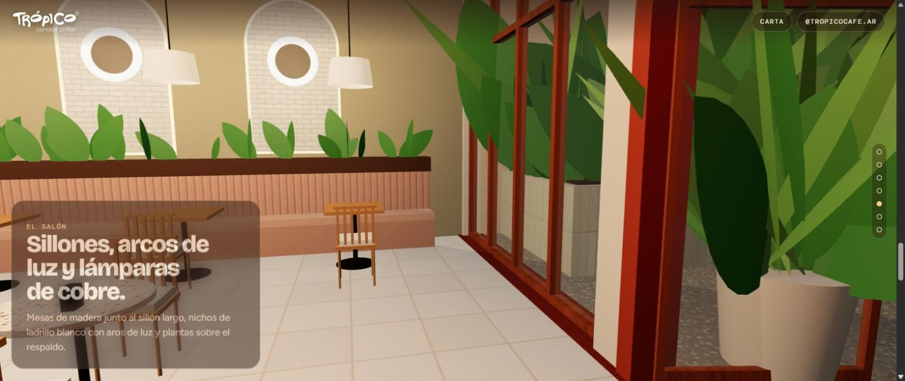
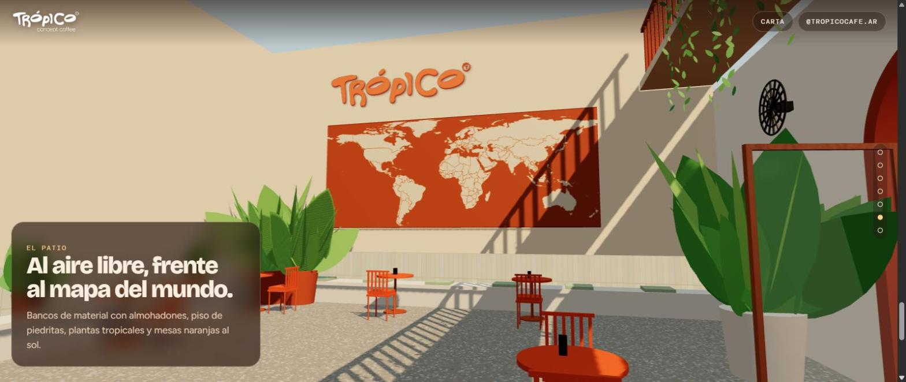
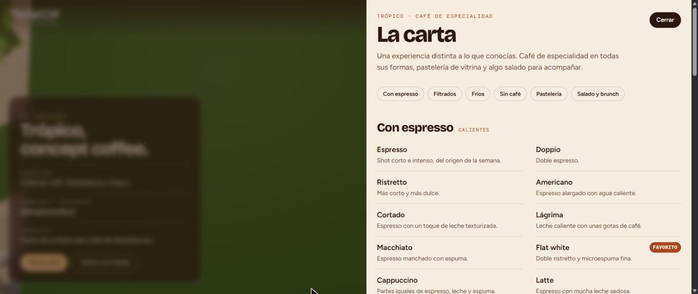

<div align="center">

# Trópico · concept coffee

### A website you walk through: a scroll-driven 3D tour of a specialty coffee shop

**[Visit the site →](https://rikochet87.github.io/tropico-cafe/)**

Client project · Güemes 330, Resistencia, Chaco, Argentina

</div>



---

## The idea

A coffee shop sells a place as much as a coffee. Instead of a gallery of photos, the home page is the café itself, modelled in 3D: you scroll and the camera walks you in from the pavement, past the pastry counter and the concept store, through the lounge and out to the patio. Each stop shows a short text about that part of the venue, and the full menu is always one click away.

## The tour

| | |
|---|---|
|  |  |
| **Entrance** — "a place where things happen" | **Pastry counter** — every product labelled in the scene, with the day's coffees alongside |
|  |  |
| **Concept store** — the island with t-shirts, tote bags, mugs and books under a rain of ceramic tubes | **Lounge** — the long sofa, brick niches with light rings, copper lamps |
|  |  |
| **Patio** — the cut-out world map, tropical plants and orange tables | **Menu** — the full menu in a side panel, by category |

The last stop has the address, Instagram and a button back to the start.

## How it was built

- **Three.js**, with everything modelled in code: the facade, furniture, plants, products and lighting are geometry written by hand, not imported models. The camera follows a path tied to the scroll position.
- **One HTML file, no build step**: HTML, CSS and JavaScript together, with the logo embedded. It runs on any static host; this one is GitHub Pages.
- The world map on the patio wall is real geography: `tools/generar-mapa.js` turns the Natural Earth country outlines into the cut-out shape.
- Built with AI agents (Claude Code) as the main development tool.

## Run it locally

Open `index.html` in a browser. Three.js and the fonts load from a CDN.

To regenerate the world map:

```bash
npm i world-atlas@2.0.2 topojson-client@3.1.0 && node tools/generar-mapa.js
```

## Files

```
index.html                         the whole page (HTML + CSS + JS, logo embedded)
assets/logo-tropico.png            cropped logo (white, transparent)
assets/logo-tropico-wordmark.png   the word "TRÓPICO" only
tools/generar-mapa.js              builds the world map outlines (Natural Earth via world-atlas)
docs/img/                          screenshots for this page
```

## Still to do

- The real menu, prices and opening hours (the current menu is a placeholder).
- A high-resolution logo (SVG).
- More detail in the lounge, from more photos of the venue.

---

<div align="center">

**Matías Rosello** · [GitHub](https://github.com/rikochet87) · rosellomatias87@gmail.com

</div>
